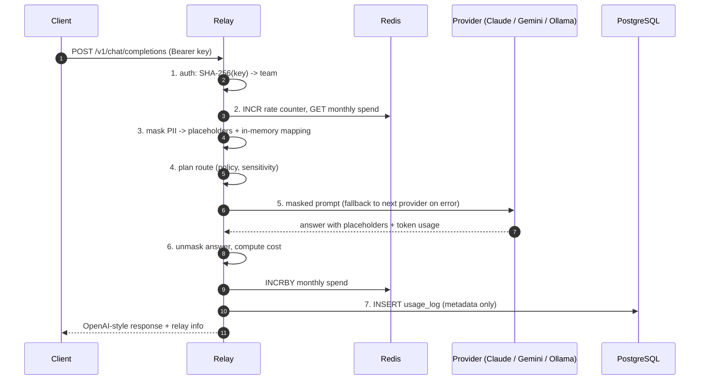

# Architecture

This document follows one request through Relay, step by step, and says where each step lives
in the code. The entry point is `chat_completions()` in [`app/main.py`](app/main.py), which
wraps `_complete()`; reading those two functions top to bottom is reading the lifecycle.



## Startup

`lifespan()` in `app/main.py` runs once per process, before traffic is served:

- reads the settings (`app/config.py`, environment variables prefixed `RELAY_`);
- loads the teams file (`TeamDirectory.from_file`);
- creates the Redis client, the database engine and the usage logger;
- loads the Presidio analyzer and the two spaCy models (`build_presidio_masker`), the slowest
  part, which is why Kubernetes uses a startup probe;
- creates one shared `httpx.AsyncClient` (connection pooling) and the provider adapters for
  the providers that are configured (`build_providers`);
- installs the OpenTelemetry tracer provider (`setup_tracing`).

## The request lifecycle

### 1. Authentication — `app/auth.py`

`authenticate()` is a FastAPI dependency (`CurrentTeam`), so it runs before the endpoint body.
It reads `Authorization: Bearer <key>`, hashes the key with SHA-256 and looks the hash up in the
`TeamDirectory`. Unknown or missing key: **401**. The result is a `Team` with its name, rate
limit and monthly budget.

From here on, `chat_completions()` has created an empty `UsageLog` row and opened the root span
`relay.chat_completion`. Whatever happens next, the `finally:` block fills in the latency and
status code and writes the row (step 7).

### 2. Limits — `app/limits.py`

- `check_rate_limit()`: `INCR relay:rate:<team>:<minute>` plus `EXPIRE` in one Redis
  transaction. Above the team's limit: **429** with `Retry-After`.
- `check_budget()`: reads `relay:budget:<team>:<YYYY-MM>` (integer micro-dollars). At or above
  the cap: **402**. Nothing has been sent to a provider yet, so a refused request costs nothing.
- Redis unreachable: **503** (fail closed).

### 3. Masking — `app/masking.py`

`Masker.mask()` runs in a worker thread (`run_in_threadpool`) because Presidio is synchronous
and CPU-bound. For every message (system, user and assistant history):

1. `guess_languages()` picks English or French from common function words (or both if unsure);
2. `detect()` runs the Presidio analyzer for that language, restricted to `PERSON`,
   `EMAIL_ADDRESS`, `PHONE_NUMBER`, `IBAN_CODE` and `FR_ADDRESS` (a custom regex recognizer,
   `french_address_recognizer()`), with a score threshold of 0.35;
3. the Presidio anonymizer resolves overlapping detections and calls our operator, which asks
   the request's `Mapping` for a placeholder: `<PERSON_1>`, `<EMAIL_ADDRESS_1>`... The same
   value always gets the same placeholder across all messages.

The `Mapping` (placeholder → original value) is a local variable of the request. It is never
written to Redis, PostgreSQL, logs or spans. Span `relay.masking` records only the count.

### 4. Routing — `app/router.py`

`Router.plan()` builds the ordered list of candidate providers:

1. parses `metadata.policy` and `metadata.sensitivity` (invalid value: **400**);
2. **data rule first**: `sensitivity=high` keeps only local providers (`is_local = True`, i.e.
   Ollama). This filter applies whatever the policy;
3. sorts by the policy: `cost` (price table in `app/pricing.py`), `latency` (moving average
   of observed latency per provider), `data_policy` (local first, then cost);
4. a pinned model (`model` other than `"auto"`) moves its provider to the front; a model that
   exists but is filtered out by the data rule: **403**; an unknown model: **404**.

Span `relay.routing` records the policy, the sensitivity and the candidate order.

### 5. Provider call and fallback — `app/router.py`, `app/providers/`

`Router.execute()` tries the candidates **one at a time, in order, each at most once**. Each
attempt is a `relay.provider_call` span.

Each adapter (`providers/anthropic.py`, `gemini.py`, `ollama.py`) translates the OpenAI-style
messages into the provider's HTTP format, calls it with httpx and normalises the answer into a
`ProviderResult` (text, model, prompt and completion tokens, finish reason). Any failure
(connection error, timeout, HTTP 4xx/5xx, unexpected JSON) becomes a `ProviderError`, built in
`Provider._post_json()` without ever including the request body.

On `ProviderError` the router records a large latency sample for that provider and moves to the
next one. If every candidate fails: **502**. The first success returns a `RouteOutcome` with
`fallback_used = True` if at least one provider failed before it.

### 6. Unmasking and cost — `app/masking.py`, `app/pricing.py`, `app/limits.py`

- `unmask()` replaces every known placeholder in the answer with the original value, in a
  single regex pass (span `relay.unmasking`).
- `cost_usd()` prices the call from the token counts, using `Decimal`. Local models cost 0;
  unknown cloud models are priced like the most expensive known model.
- `Limiter.record_spend()` adds the cost to the team's monthly counter (`INCRBY`). Only the
  call that produced the answer is charged.

### 7. Usage logging — `app/db.py`, `app/models.py`

`UsageLogger.log()` inserts one `usage_log` row: time, team, HTTP status, policy, provider,
model, prompt and completion tokens, cost, latency, fallback used, masked entity count, and a
short machine-generated error reason when relevant. There is no column for content. A failure
to write the row is logged but does not fail the user's request.

The schema is managed by Alembic (`alembic/versions/`). Migrations run at container start in
Docker Compose, and in an initContainer in Kubernetes, where a PostgreSQL advisory lock
(`alembic/env.py`) makes concurrent pods take turns.

## Where data lives

| Data | Where | Lifetime |
|---|---|---|
| Prompt and answer text | Process memory only | The request |
| Placeholder mapping | Process memory only | The request |
| Masked prompt | Sent to the chosen provider | The provider's own retention policy |
| Team key hashes, limits, budgets | Teams file / Kubernetes Secret | Until changed |
| Rate counters | Redis | 2 minutes |
| Monthly spend per team | Redis | ~40 days |
| Usage log (metadata) | PostgreSQL | Until deleted (define a retention policy) |
| Traces (metadata) | OpenTelemetry Collector → backend | Backend retention |

## Failure modes

| Failure | Behaviour |
|---|---|
| One provider down or slow | Fallback to the next allowed provider; `fallback_used = true` |
| Every allowed provider down | 502, logged with the reasons (`ollama: timeout; ...`) |
| Redis down | 503 before any provider call (limits fail closed); if Redis fails after the call, the spend is logged as an error, the answer is still returned |
| PostgreSQL down | The answer is returned; the missing usage row is logged as an error |
| Presidio misses a value | That value reaches the provider: see Limitations in the README |

## Repository map

```
app/main.py            routes, lifespan, request lifecycle
app/config.py          settings (RELAY_* environment variables)
app/auth.py            team keys (SHA-256), `python -m app.auth new-key`
app/limits.py          Redis rate limit and monthly budget
app/masking.py         Presidio masking, French address recognizer, unmasking
app/router.py          policies, fallback, latency tracking
app/providers/         base.py (interface, errors), anthropic.py, gemini.py, ollama.py
app/pricing.py         price table and cost calculation
app/db.py, models.py   SQLAlchemy engine, usage_log table, usage logger
app/telemetry.py       OpenTelemetry setup
alembic/               migrations
eval/masking/          labeled dataset and evaluation script
sdk/                   relay-client package
examples/rag_assistant BM25 retrieval + Relay through the SDK
deploy/                helm chart, terraform (OKE), grafana, otel collector, postgres init
```
