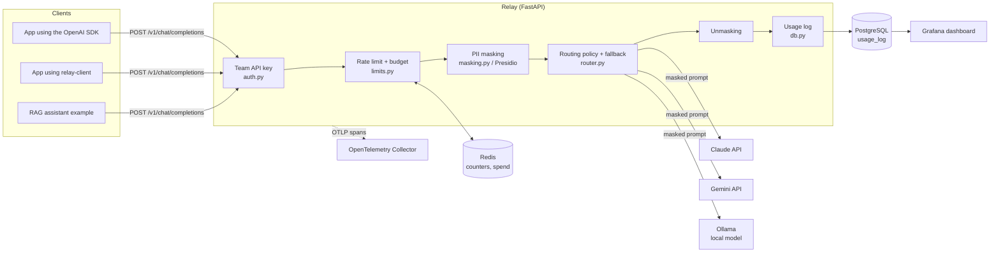

# Relay

**An open-source enterprise LLM gateway: one OpenAI-compatible API in front of Claude, Gemini
and a local Ollama model, with PII masking, per-team budgets and full observability.**

## What Relay solves

When every team in a company calls LLM APIs on its own, the same problems show up everywhere:

| Problem | What Relay does |
|---|---|
| Personal data is pasted into prompts and sent to third-party vendors | Detects names, emails, phones, IBANs and French addresses with Microsoft Presidio, replaces them with placeholders before the prompt leaves, and restores them in the answer |
| Every app is coupled to one vendor's SDK | One OpenAI-compatible endpoint; existing OpenAI clients work by changing the base URL |
| Some data must never leave the company | `sensitivity: high` requests can only go to the local model (Ollama) |
| An outage at one vendor breaks every app | Automatic fallback to the next allowed provider |
| Nobody knows who spends what | Per-team API keys, rate limits and monthly budget caps (Redis); every call logged with tokens, cost and latency (PostgreSQL) |
| No visibility in production | OpenTelemetry traces for each step and a provisioned Grafana dashboard |

## Architecture



The request lifecycle (auth → limits → masking → routing → provider → unmasking → logging) is
described step by step, with the code for each step, in [ARCHITECTURE.md](ARCHITECTURE.md).
The reasoning behind the main choices is in [docs/DECISIONS.md](docs/DECISIONS.md).

## Quickstart (3 commands)

Requires Docker with Compose, `make` and Python 3. No cloud API key is needed: without keys,
Relay runs with the local Ollama model only.

```bash
git clone https://github.com/<your-user>/relay-llm-gateway && cd relay-llm-gateway
make up     # creates .env from .env.example, starts the 6 containers, pulls the Ollama model
make demo   # sends a prompt full of PII and shows what the provider saw vs. what you got back
```

`make demo` prints the two sides next to each other (output from a local run):

```
SENT TO THE PROVIDER (masked)                              | RETURNED TO THE CALLER (restored)
-----------------------------------------------------------+-----------------------------------------------------------
Write a short, polite reply to this customer message and   | Dear Marie Dupont, we are sorry your parcel did not reach
address the customer by name. Message: 'Hello, I am        | 12 rue de la Paix, 75002 Paris. We will call you on 06 12
<PERSON_1>. My parcel was supposed to arrive at            | 34 56 78 and refund FR76 3000 6000 0112 3456 7890 189
<FR_ADDRESS_1> last week. You can call me on               | today.
<PHONE_NUMBER_1> or write to <EMAIL_ADDRESS_1>. Please     |
refund me on <IBAN_CODE_1>.'                               |

provider=ollama  model=llama3.2:3b  masked_entities=5  fallback_used=False  cost_usd=0.0
```

(That output came from the real Relay app and Presidio models with a stub in place of Ollama;
see [Project status](#project-status).)

Then open Grafana at http://localhost:3000 (user `admin`, password `GRAFANA_ADMIN_PASSWORD`
from `.env`). To add cloud providers, set `RELAY_ANTHROPIC_API_KEY` and/or
`RELAY_GEMINI_API_KEY` in `.env` and run `make up` again.

## Using Relay

### With curl

```bash
curl -s http://localhost:8000/v1/chat/completions \
  -H "Authorization: Bearer relay-demo-key" \
  -H "Content-Type: application/json" \
  -d '{
        "model": "auto",
        "messages": [{"role": "user", "content": "Draft a reply to Jean Dupont (jean.dupont@example.fr)."}],
        "metadata": {"policy": "cost", "sensitivity": "high"}
      }'
```

The response is a standard OpenAI `chat.completion`, plus a `relay` object:

```json
"relay": {"provider": "ollama", "fallback_used": false, "masked_entities": 2, "cost_usd": 0.0, "masked_messages": null}
```

### With the SDK (`sdk/`)

```python
from relay_client import RelayClient  # pip install -e ./sdk

with RelayClient(base_url="http://localhost:8000", api_key="relay-demo-key") as relay:
    result = relay.chat("Summarise the complaint from Jean Dupont.", policy="data_policy")
    print(result.content, result.provider, result.masked_entities, result.cost_usd)
```

### With the official OpenAI SDK

```python
from openai import OpenAI

client = OpenAI(base_url="http://localhost:8000/v1", api_key="relay-demo-key")
reply = client.chat.completions.create(
    model="auto",
    messages=[{"role": "user", "content": "Hello"}],
    metadata={"policy": "latency"},
)
```

### Routing hints

| `metadata` key | Values | Effect |
|---|---|---|
| `policy` | `cost` (default) | Cheapest provider first (price table in `app/pricing.py`) |
| | `latency` | Lowest observed latency first (moving average per provider) |
| | `data_policy` | Local provider first, then cheapest |
| `sensitivity` | `low` (default) | Any configured provider |
| | `high` | Local provider only, whatever the policy; no fallback to the cloud |

`model: "auto"` lets the policy choose; a concrete model id (see `GET /v1/models`) is tried
first, with the other allowed providers as fallback.

### Team keys

Teams are declared in a JSON file (`RELAY_TEAMS_FILE`) that stores only the SHA-256 of each key:

```bash
python -m app.auth new-key finance   # prints a new key once, and the entry to add to the file
```

Errors: `401` bad key, `429` rate limit (with `Retry-After`), `402` monthly budget reached,
`403` model not allowed for this sensitivity, `502` every allowed provider failed,
`503` Redis unavailable (limits fail closed).

## Masking evaluation

The CI runs [`eval/masking/run_eval.py`](eval/masking/run_eval.py) on a labeled dataset of 40
prompts in English and French (35 containing PII, 5 without), with the real Presidio and spaCy
models. The build fails if recall drops below 90%.

| Metric | Result |
|---|---|
| Recall (PII values fully masked) | **100%** (55/55) |
| Precision (detections that were real PII) | **95.0%** (57/60) |

| Entity | Recall |
|---|---|
| PERSON | 24/24 |
| EMAIL_ADDRESS | 10/10 |
| PHONE_NUMBER | 8/8 |
| IBAN_CODE | 7/7 |
| FR_ADDRESS | 6/6 |

The 3 false positives are French imperative verbs at the start of a sentence ("Rédige",
"Traduis", "Livraison") tagged as names by the French spaCy model. A 100% recall on 40 prompts
I wrote myself does not mean 100% in production: see [Limitations](#limitations).

## Observability

- **Usage log**: one PostgreSQL row per request (team, provider, model, prompt and completion
  tokens, cost in USD, latency, fallback used, masking count, status). Prompt and completion
  text are never stored: the table has no column for them.
- **Traces**: one trace per request with spans `relay.masking`, `relay.routing`,
  `relay.provider_call` (one per attempt) and `relay.unmasking`, sent over OTLP to the
  OpenTelemetry Collector (`docker compose logs otel-collector` shows them).
- **Grafana**: the provisioned "Relay overview" dashboard shows requests, spend per team,
  latency p50/p95, error rate, fallback rate, masked entities and refused requests.

> _Screenshot placeholder: add `docs/grafana.png` after running `make up` and `make demo`._
> ``

## Deployment

- **Docker Compose** (`docker-compose.yml`): relay, postgres, redis, ollama, otel-collector, grafana.
- **Kubernetes** (`deploy/helm/relay`): Deployment with a migration initContainer, startup /
  readiness / liveness probes, non-root and read-only root filesystem, secrets from an existing
  Secret. Postgres, Redis, Ollama and the collector are expected to exist in the cluster.
- **Oracle Cloud** (`deploy/terraform`): VCN with a private node subnet, an OKE cluster whose
  API endpoint is restricted to one CIDR, and a node pool. `terraform apply` then
  `helm install relay deploy/helm/relay -f my-values.yaml`.

## Development

```bash
python -m venv .venv && source .venv/bin/activate
make install          # Relay + SDK + dev tools
make lint test        # ruff, mypy, fast tests (Presidio detection faked)
make models eval      # real Presidio models + masking evaluation
```

Tests never call a real provider: every HTTP call to Claude, Gemini or Ollama is mocked with
respx. CI (`.github/workflows/ci.yml`) runs lint, type check, tests, the masking evaluation, a
Docker build, `helm lint` / `helm template`, `terraform fmt -check` / `terraform validate` and
a gitleaks secret scan.

## Project status

What has been verified, and what has not:

| Item | Status |
|---|---|
| Unit and integration tests (63 + 2 Presidio tests) | Pass locally (Windows, Python 3.12) |
| Masking evaluation | Pass locally (numbers above) |
| End-to-end request through the real app | Done locally with the real Presidio models and the real Alembic migration, but with SQLite instead of PostgreSQL, an in-memory Redis, and a stub instead of Ollama |
| `docker compose` stack, `make up`, `make demo` | **Not run yet**: Docker was not available on the build machine |
| Helm chart | `helm lint` and `helm template` pass; **not yet deployed to a cluster** (not tested with kind) |
| OCI Terraform | `terraform fmt -check` and `terraform validate` pass; **not applied** to OCI |
| Real Claude / Gemini calls | Not made (no API keys used); the adapters follow the public HTTP APIs and are tested against mocked responses |

## Limitations

- **PII detection is probabilistic.** Regex and NER-based detection misses unusual names, PII
  written in odd formats, PII in languages other than English and French, and indirect
  identifiers ("the CFO of our Lyon office"). Masking reduces exposure; it does not guarantee
  anonymisation in the GDPR sense.
- **Non-streaming only.** `stream: true` is rejected (unmasking a stream needs buffering
  around placeholders that may be split across chunks).
- **Text only.** Images, audio and tool/function calling are not supported.
- **Budget overshoot.** The budget is checked before a call (its cost is unknown until the
  provider answers), so concurrent in-flight requests can exceed the cap slightly.
- **Fixed-window rate limit.** Up to 2x the limit can pass around a minute boundary.
- **Latency routing is per replica.** Each Relay process learns latencies on its own.
- **Prices are a static table** (`app/pricing.py`) to update by hand when vendors change them.
- **Traces are not stored.** The collector prints them; plug a backend (Tempo, Jaeger...) into
  `deploy/otel-collector/config.yaml` to keep them.

## License

[MIT](LICENSE)
